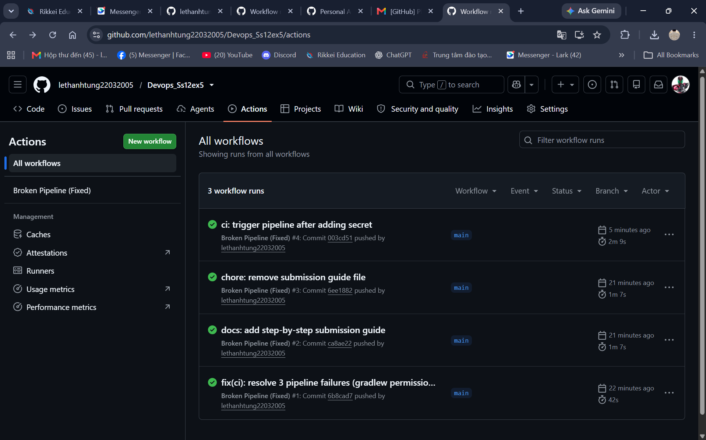

# Troubleshooting — Khắc phục 3 sự cố đứt gãy Pipeline CI/CD

**Bài 5 — Session 12** · File kịch bản: [`.github/workflows/broken-pipeline.yml`](.github/workflows/broken-pipeline.yml)

Pipeline gồm 2 job: `build-and-test` (Gradle) và `docker-build-push` (Docker/GHCR).
Ban đầu pipeline đỏ (fail) ở cả 3 điểm dưới đây. Tài liệu này ghi lại log lỗi, nguyên nhân gốc và cách khắc phục.

---

## Tổng quan 3 lỗi

| # | Lỗi | Bước | Nguyên nhân gốc | Cách khắc phục |
|---|-----|------|------------------|----------------|
| 1 | Permission Denied | Grant execute permission for gradlew | Wrapper mất quyền thực thi sau checkout | Thêm `run: chmod +x gradlew` |
| 2 | Authentication Failed | Log in to the Container registry | Sai chính tả tên secret (`REGISTRY_TOKEM`) | Dùng đúng `${{ secrets.REGISTRY_TOKEN }}` |
| 3 | Build Context Error | Build and push Docker image | Sai thư mục build context/Dockerfile | `context: .` và `file: ./Dockerfile` |

---

## Lỗi 1 — Permission Denied (Gradle Wrapper)

### Log lỗi
```
Run ./gradlew --no-daemon test
/home/runner/work/.../gradlew: Permission denied
Error: Process completed with exit code 126.
```

### Nguyên nhân
Git không lưu thuộc tính thực thi (executable bit) trên một số hệ thống, nên sau khi
`actions/checkout@v4` chạy trên Runner Ubuntu, file `gradlew` không có quyền `+x`.
Shell cố thực thi file nhưng bị hệ điều hành từ chối → exit code `126`.

### Cách sửa
Cấp quyền thực thi **trước** khi gọi `./gradlew`:

```yaml
      - name: Grant execute permission for gradlew
        run: chmod +x gradlew
```

### Kết quả
`./gradlew --no-daemon test` chạy được, unit test `AppTest` pass.

---

## Lỗi 2 — Authentication Failed (Docker Registry)

### Log lỗi
```
Error: Cannot perform an interactive login from a non TTY device
Error response from daemon: Get "https://ghcr.io/v2/": denied: denied
Error: failed to authorize: ... 401 Unauthorized
```

### Nguyên nhân
Bước `docker/login-action` truyền sai tên biến secret:

```yaml
          password: ${{ secrets.REGISTRY_TOKEM }}   # ❌ sai chính tả: TOKEM
```

Secret `REGISTRY_TOKEM` không tồn tại → GitHub Actions resolve thành chuỗi rỗng →
Docker login với password rỗng → `401 Unauthorized`.

### Cách sửa
Dùng đúng tên secret đã khai báo trong **Settings → Secrets and variables → Actions**
(giá trị là một Personal Access Token có scope `write:packages`):

```yaml
      - name: Log in to the Container registry
        uses: docker/login-action@v3
        with:
          registry: ${{ env.REGISTRY }}
          username: ${{ github.actor }}
          password: ${{ secrets.REGISTRY_TOKEN }}   # ✅ đúng tên
```

### Kết quả
`Login Succeeded` và có thể push image lên `ghcr.io`.

---

## Lỗi 3 — Build Context Error (Dockerfile không tìm thấy)

### Log lỗi
```
ERROR: failed to solve: failed to read dockerfile: open /tmp/buildkit-mount.../app/Dockerfile: no such file or directory
Error: buildx failed with: ERROR: failed to solve: ...
```

### Nguyên nhân
Cấu hình context bị trỏ sai vào thư mục con `./app`, nơi không có `Dockerfile`:

```yaml
        with:
          context: ./app               # ❌ sai thư mục
          file: ./app/Dockerfile       # ❌ sai đường dẫn
```

### Cách sửa
Context phải là thư mục gốc repo (nơi đặt `Dockerfile` và mã nguồn), file trỏ đúng tên:

```yaml
      - name: Build and push Docker image
        uses: docker/build-push-action@v5
        with:
          context: .                   # ✅ gốc repository
          file: ./Dockerfile           # ✅ đúng đường dẫn
          push: true
          tags: |
            ${{ steps.meta.outputs.image }}:latest
            ${{ steps.meta.outputs.image }}:${{ github.sha }}
```

### Kết quả
BuildKit tìm thấy Dockerfile, build thành công và push image.

---

## Cấu hình cần thiết trước khi chạy

1. **Tạo secret `REGISTRY_TOKEN`**: repo → *Settings → Secrets and variables → Actions → New repository secret*.
   - Tên: `REGISTRY_TOKEN`
   - Giá trị: PAT (classic) có scope `read:packages`, `write:packages` (và `delete:packages` nếu cần).
2. `GITHUB_TOKEN` mặc định đã đủ cho checkout; job Docker cấp thêm quyền `packages: write` qua `permissions`.

## Xác minh (kiểm tra tích xanh)

```bash
git add .
git commit -m "fix(ci): resolve gradlew permission, registry secret typo, docker build context"
git push origin main
```

Mở tab **Actions** → chọn workflow **Broken Pipeline (Fixed)** → cả 2 job
`build-and-test` và `docker-build-push` phải chuyển **màu xanh ✅**.



---

## Ghi chú phụ (không bắt buộc)

- Image name được viết thường bằng `${GITHUB_REPOSITORY,,}` vì Docker registry yêu cầu
  tên repository chữ thường.
- Đã bật cache `type=gha` cho BuildKit để tăng tốc các lần build sau.
